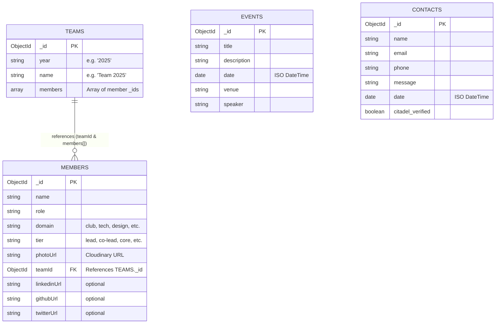

# Database Structure and Architecture

## 1. Overview & Deployment Topology

* **Cluster:** MongoDB Atlas 3-node Replica Set (`atlas-20a61o-shard-0`)
* **Database Name:** `test`
* **Driver:** Official MongoDB Node.js Driver (`mongodb` package)
* **Connection Management:** Singleton client pooling with DNS resolution fallbacks (`8.8.8.8`, `1.1.1.1`) located at [`src/lib/mongodb.ts`](src/lib/mongodb.ts).
* **Application API Architecture:** Next.js Route Handlers interact with the database collections directly using `client.db().collection(...)`.

> **Note on Schemas:** Mongoose schema definitions exist under `src/lib/models/` (`Team.ts`, `Event.ts`, `Contact.ts`), but the active production API routes execute queries via the native `mongodb` driver.

---

## 2. Entity-Relationship (ER) Diagram



---

## 3. Collections & Schemas

### 3.1. `teams` Collection
Stores top-level team grouping for each batch or academic year.

* **Live Document Count:** 1 document (`"2025"`)
* **Primary Query:** `db.collection("teams").findOne({ year })`

| Field | Type | Required | Description |
| :--- | :--- | :---: | :--- |
| `_id` | `ObjectId` | Yes | MongoDB primary key identifier |
| `year` | `string` | Yes | Year identifier (stored as string, e.g., `"2025"`) |
| `name` | `string` | Yes | Display title (e.g., `"Team 2025"`) |
| `members` | `string[]` / `ObjectId[]` | Yes | Array of referenced `members._id` values |

#### Sample Document:
```json
{
  "_id": { "$oid": "68f0f7891bb9d7483dd34f70" },
  "year": "2025",
  "name": "Team 2025",
  "members": [
    "68f2312f918d7b9b0cecde55",
    "68f23531918d7b9b0cecde58",
    "68f235a3918d7b9b0cecde59"
  ]
}
```

---

### 3.2. `members` Collection
Stores individual GDG member profiles. Normalized relationship referencing `teams._id`.

* **Live Document Count:** 77 documents
* **Primary Query:** `db.collection("members").find({ teamId: new ObjectId(team._id) })`

| Field | Type | Required | In Live DB? | Description |
| :--- | :--- | :---: | :---: | :--- |
| `_id` | `ObjectId` | Yes | Yes (100%) | MongoDB primary key identifier |
| `name` | `string` | Yes | Yes (100%) | Member's full name |
| `role` | `string` | Yes | Yes (100%) | Role designation (e.g., `"GDG Co-Lead"`, `"Tech Lead"`, `"Android Domain Core"`) |
| `domain` | `string` | Yes | Yes (100%) | Functional department (see Allowed Domains) |
| `tier` | `string` | Yes | Yes (100%) | Seniority / organizational rank (see Allowed Tiers) |
| `photoUrl` | `string` | No | Yes (100%) | Cloudinary hosted profile photo URL |
| `teamId` | `ObjectId` / `string` | Yes | Yes (100%) | Foreign key reference to `teams._id` |
| `linkedinUrl` | `string` | No | **No (0/77)** | In TS types only; currently defaults to `"https://linkedin.com"` in UI |
| `githubUrl` | `string` | No | **No (0/77)** | In TS types only; currently defaults to `"https://github.com"` in UI |
| `twitterUrl` | `string` | No | **No (0/77)** | In TS types only; currently defaults to `"https://x.com"` in UI |

#### Allowed Domains:
* `club`
* `tech`
* `design`
* `content and documentation`
* `pr & marketing`
* `social media`
* `operations`

#### Allowed Tiers:
* `faculty coordinator`
* `lead`
* `co-lead`
* `student-advisor`
* `mentor`
* `core`
* `member`
* `past`
* `recruit`

#### Sample Document:
```json
{
  "_id": { "$oid": "68f2312f918d7b9b0cecde55" },
  "name": "Surendra Tripathi",
  "role": "GDG Co-Lead",
  "domain": "club",
  "tier": "co-lead",
  "photoUrl": "https://res.cloudinary.com/dpcmrbykl/image/upload/v1760702766/member_photos/bnthom4zuinwemdvfhsj.png",
  "teamId": "68f0f7891bb9d7483dd34f70"
}
```

---

### 3.3. `events` Collection
Stores community events, hackathons, and workshops.

* **Live Document Count:** 7 documents
* **Primary Query:**
  * Past events: `db.collection("events").find({ date: { $lt: now } }).sort({ date: 1 })`
  * Upcoming events: `db.collection("events").find({ date: { $gte: now } }).sort({ date: 1 })`

| Field | Type | Required | Description |
| :--- | :--- | :---: | :--- |
| `_id` | `ObjectId` | Yes | MongoDB primary key identifier |
| `title` | `string` | Yes | Event title (e.g. `"CodeSprint 3.0 2025"`) |
| `description` | `string` | No | Overview and agenda |
| `date` | `Date` (ISODate) | Yes | Event date and scheduled start |
| `venue` | `string` | No | Physical hall, room, or meet link |
| `speaker` | `string` | No | Speaker / presenter name or `null` |

#### Sample Document:
```json
{
  "_id": { "$oid": "68fd52515198cff7a5a34ae4" },
  "title": "CodeSprint 3.0 2025",
  "description": "GDG NMIT's annual premium coding extravaganza! Join us for a 7-hour coding event with competitive programming challenges, problem-solving, and networking opportunities.",
  "date": "2025-04-04T00:00:00.000Z",
  "venue": "Room 271, D Block, NMIT",
  "speaker": null
}
```

---

### 3.4. `contacts` Collection
Stores contact and collaboration messages sent through the website contact form. Verified and sanitized by Citadel.

* **Live Document Count:** 13 documents
* **Insertion Endpoint:** `POST /api/contact`

| Field | Type | Required | Description |
| :--- | :--- | :---: | :--- |
| `_id` | `ObjectId` | Yes | MongoDB primary key identifier |
| `name` | `string` | Yes | Sender full name |
| `email` | `string` | Yes | Sender email |
| `phone` | `string` | Yes | Sender telephone number |
| `message` | `string` | Yes | Message body |
| `date` | `Date` (ISODate) | Yes | Submission timestamp |
| `citadel_verified` | `boolean` | No | Flag indicating request passed security filters |

#### Sample Document:
```json
{
  "_id": { "$oid": "6911b2aef816b93ca78d94a7" },
  "name": "Sakshi Sankeshwari",
  "email": "sakshi.sankeshwari@expinfi.com",
  "phone": "9606678465",
  "message": "Hey GDG NMIT Team, This is Sakshi from Bhanzu...",
  "date": "2025-11-10T09:38:54.137Z",
  "citadel_verified": true
}
```

---

## 4. Current Indexes (Live Audit)

All 4 collections currently possess only default primary key indexes:
* `contacts`: `_id_` (`{ _id: 1 }`)
* `teams`: `_id_` (`{ _id: 1 }`)
* `members`: `_id_` (`{ _id: 1 }`)
* `events`: `_id_` (`{ _id: 1 }`)

---

## 5. Architectural Findings & Recommended Improvements

1. **Recommended Database Indexes:**
   * **`members` collection:** Create `{ teamId: 1, domain: 1 }` to optimize filtering and joining in `/api/teams`.
   * **`teams` collection:** Create a unique index `{ year: 1 }` to prevent duplicate team creation and speed up lookups by year.
   * **`events` collection:** Create `{ date: 1 }` to index the sorting and range queries used by `GET /api/events`.

2. **Schema Uniformity & Social Links Discrepancy:**
   * **Social URLs (`linkedinUrl`, `githubUrl`, `twitterUrl`):** Found in `src/types/team.ts` and `src/components/Team.tsx`, but **0 out of 77 documents in MongoDB actually contain them**. Furthermore, the member creation endpoint (`POST /api/teams/[teamId]/members`) does not parse or persist these fields. Currently, the UI falls back to generic root URLs (`https://github.com`, `https://linkedin.com`, `https://x.com`). If individual social links are needed, both the API endpoint and MongoDB documents need to be updated.
   * **`teams.year`:** Stored as `string` (`"2025"`) in the database and queried as string in `api/teams/route.ts`, but declared as `Number` in the Mongoose schema (`src/lib/models/Team.ts`). Keeping this consistently typed as `string` avoids parsing issues.
   * **`members.teamId`:** When inserting members via `POST /api/teams/[teamId]/members`, `teamId` is saved as an `ObjectId`, but some seed scripts or legacy records may store it as a plain `string`. It is best practice to cast with `new ObjectId(...)` uniformly.

3. **Asset Storage:**
   * Images are not stored as binary inside MongoDB. They are uploaded to Cloudinary (`folder: "member_photos"`), and only the resulting HTTPS CDN URL is stored in `members.photoUrl`.

